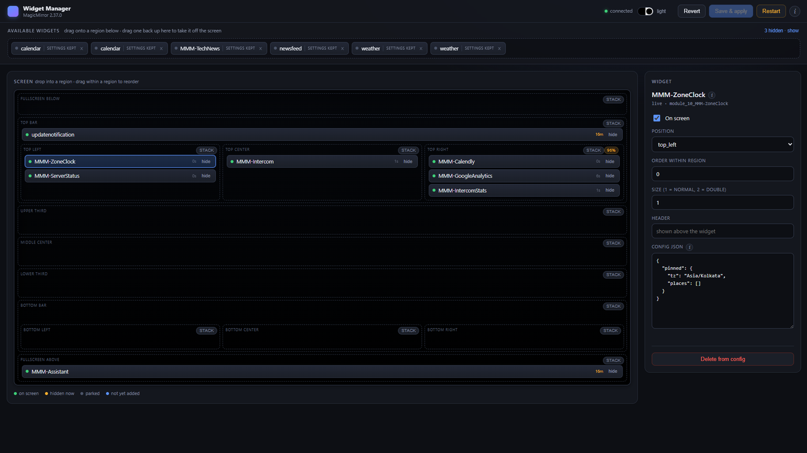
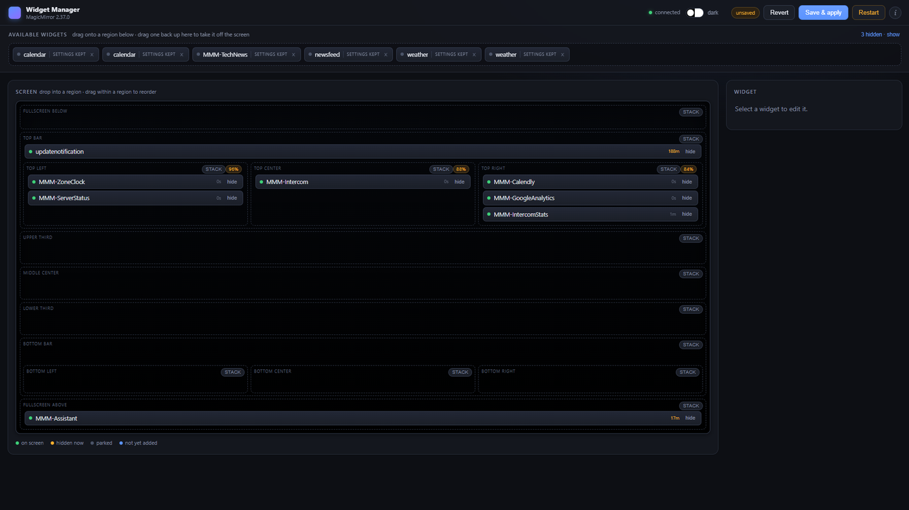

<div align="center">

# MMM-WidgetManager

**Manage your whole MagicMirror² screen from one page.**

Drag widgets between regions, edit their settings, and see it on the mirror in about three
seconds — without restarting.

[](LICENSE)
[](https://magicmirror.builders/)
[](docs/setup.md#1-requirements)

</div>


MagicMirror has thirteen regions and no way to see them. Once a mirror has a dozen modules, the
question stops being *"what is `MMM-Foo`'s config"* and becomes *"what is actually where, and what
happens if I move this"*. This answers that.

Most changes apply to the running mirror in about three seconds rather than the usual twenty-second
restart. [That turns out to be possible for an interesting reason →](docs/how-it-works.md)

## What you can do

- **See the screen** — all thirteen regions in their real nested arrangement. Drag between them to
  change a widget's `position`; drag within one to reorder.
- **Edit any widget** — JSON config with live validation, plus header and position. The **i**
  reads that module's own `defaults` out of its source, so you can see what is configurable
  without going to find the file.
- **Add and remove** — anything installed but not yet in your config is one click away.
- **See what is actually working** — every widget shows how long since it last redrew. On the
  mirror, a feed that died an hour ago looks identical to a healthy one.
- **Tune the fit** — per-widget scaling, side-by-side region layout, and a dark/light toggle.

## Install

```bash
cd ~/MagicMirror/modules
git clone https://github.com/geekksv/MMM-WidgetManager.git
```

```js
{
    module: "MMM-WidgetManager",
    config: {
        showUrl: false
    }
}
```

Restart the mirror once, then open **`http://<mirror-ip>:8080/widgets`**.

No `position` is needed — the module renders nothing on the mirror. No dependencies, no build step.

> **Panel refuses to connect from another machine?** MagicMirror binds `127.0.0.1` by default.
> [Two lines of config fix it →](docs/setup.md#3-reaching-it-from-another-machine)

## Documentation

| | |
|---|---|
| **[Setup guide](docs/setup.md)** | Installing, reaching the panel over your network, adding it to a mirror you have already tuned, updating, troubleshooting |
| **[Configuration](docs/configuration.md)** | Every option, status chips, the `--mm-ink` theming convention |
| **[How it works](docs/how-it-works.md)** | Why changes apply without a restart, and the one case that still needs one |
| **[Controlling the mirror](docs/controlling-the-mirror.md)** | The `mm` command — start, stop, restart and read logs from a shell |

## A look inside

**The inspector.** Position, order, header and config for the selected widget.



**Auto-fit.** Each region reports the scale it settled on — `96%` means those widgets were shrunk
slightly to fit, so you can see a layout is tight before it visibly clips.



## Why this exists

Two good modules cover parts of this job. Neither covers the part I wanted:

| | What it does |
|---|---|
| [MMM-Config](https://github.com/sdetweil/MMM-Config) | Generates a **form** for editing module settings |
| [MMM-Remote-Control](https://github.com/Jopyth/MMM-Remote-Control) | **Live control** — power, module visibility, remote actions |
| **MMM-WidgetManager** | A **map of the screen** you rearrange directly, and config editing, in one page |

## Security

**There is no authentication.** This page can rewrite `config.js` and restart the mirror, and it is
reachable by anyone who can reach the mirror's web server — protected only by MagicMirror's
`ipWhitelist`, the same posture as MagicMirror's own `/config` endpoint.

Keep `ipWhitelist` tight. Never forward port 8080 through a router.

## Licence

MIT — see [LICENSE](LICENSE). MagicMirror² itself is MIT, © Michael Teeuw.
