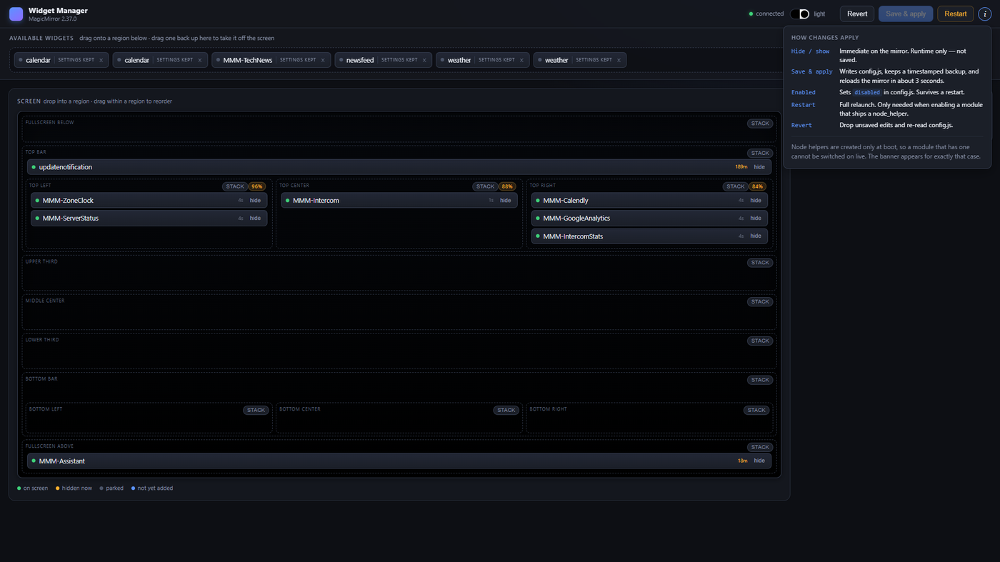

# How it works

Why layout changes reach the mirror in about three seconds instead of twenty, what the single
exception is, and where the seams are.

Worth reading if you write MagicMirror modules — the mechanism is not obvious, and it is reusable.

---

## The problem

MagicMirror serves its configuration to the browser from `/config`. That endpoint reads from an
object captured **once, at startup** (`js/server.js:115`). It never re-reads `config.js`.

So the obvious approach to a config editor — write the file, tell the page to reload — does
nothing. The page reloads and is served the same startup snapshot it had before. This is why
editing MagicMirror's config has traditionally meant restarting the process, and why the usual
advice is to budget twenty seconds and a black screen for every layout tweak.

## The mechanism

`global.config` (`js/app.js:189`) and the object `/config` serves are the **same reference**.

Following it through: `js/app.js:235` constructs `new Server(configObj)`, passing the very
`configObj` whose `fullConf` was assigned to `global.config`. The server holds that reference and
serves from it. Nothing copies it.

An object held by reference can be mutated in place. So the helper:

1. Writes the new `config.js` to disk, with a timestamped backup of the previous file.
2. Mutates the in-memory config object **in place** to match.
3. Asks the mirror page to reload.

The reload requests `/config`, gets the mutated object, and renders the new layout. About three
seconds, against roughly twenty for a process restart — and no black screen.

Point 1 is what makes it durable rather than a trick: the file and the live object are updated
together, so the change survives the next real restart.

## The one exception

**Node helpers are instantiated only at boot, and `disabled` entries are skipped then**
(`js/app.js:216`).

So enabling a module that ships a `node_helper.js` — whether newly added, or un-parked after being
disabled — cannot work live. The helper does not exist in the running process, and nothing short
of a restart will create it.

The panel detects exactly this case and raises the restart banner. Nothing else triggers it, which
means the banner is informative rather than noise: when you see it, a restart is genuinely
required.

---

## Where the seams are

The module is deliberately split down the line of what needs privilege.

**Mirror side** (`MMM-WidgetManager.js`) renders nothing by default. Two jobs:

- Report the live module list back to the helper, so the panel knows what is genuinely on screen
  rather than only what is configured. This is where the liveness ages come from.
- Apply layout changes to the running mirror — show/hide, region moves, per-widget `zoom`, region
  flow, theme — so edits feel immediate.

**Server side** (`node_helper.js`) owns everything touching the filesystem or the process:
discovering installed modules, reading and rewriting `config.js`, and restarting the mirror. None
of that can happen in a browser, and none of it should.

**Browser side** (`public/`) is a plain page served by MagicMirror's own express app on the socket
namespace the module registers. No build step, no framework, no dependencies.

---

## Consequences worth knowing

These follow from the design rather than being bugs to fix.

**Saving rewrites `config.js` as JSON.** The helper parses, applies, and writes back. Comments do
not survive, and computed expressions are evaluated — `7 * 24 * 60 * 60 * 1000` becomes
`604800000`. A timestamped backup is written before every save.

**Live hide/show is not persisted.** It is runtime state on the mirror, deliberately: it changes
no config, so it cannot be got wrong, and it vanishes on restart. Use the **Enabled** checkbox and
**Save** for something that should stick.

**The panel reflects the mirror, not just the file.** A module in `config.js` that failed to load
shows as absent, because the live list comes from the mirror rather than the config. That is the
point — it is the difference between "configured" and "working".

---

## Next

- **[Setup guide](setup.md)** — installing and integrating
- **[Configuration](configuration.md)** — every option
- **[Controlling the mirror](controlling-the-mirror.md)** — the `mm` command
