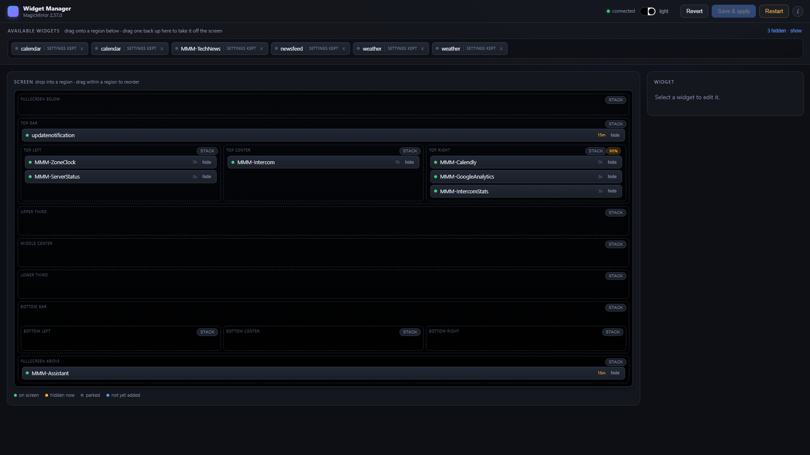

# Setup guide

Getting MMM-WidgetManager running on your own MagicMirror², from nothing to a working panel.

If you already run MagicMirror and just want the commands, the four steps in
[§2](#2-install) are the whole job. The rest of this page is the things that actually catch
people out.

---

## 1. Requirements

| | |
|---|---|
| MagicMirror² | 2.x — developed against 2.37.0 |
| Node | 18 or newer, which MagicMirror already requires |
| Dependencies | **None.** No `npm install` step; the module uses only what MagicMirror ships |
| Browser | Any modern one, on any machine that can reach the mirror |

The panel runs in your browser, not on the mirror's screen. The mirror needs no display attached
for it to work.

---

## 2. Install

### Step 1 — clone it

```bash
cd ~/MagicMirror/modules
git clone https://github.com/geekksv/MMM-WidgetManager.git
```

### Step 2 — add it to `config.js`

```js
{
    module: "MMM-WidgetManager",
    config: {
        showUrl: false      // true prints the panel's URL on the mirror itself
    }
}
```

**No `position` is needed.** The module renders nothing on the mirror unless `showUrl` is set, so
it does not belong to a region.

### Step 3 — restart the mirror, once

```bash
pm2 restart mm          # or: systemctl restart magicmirror, or your usual command
```

This one restart is unavoidable, and it is worth knowing why: MagicMirror instantiates node
helpers **only at boot** (`js/app.js:216`). A module that ships one — as this does — cannot be
switched on in a running mirror.

That is also the last restart you will need for layout changes. From here the panel applies edits
to the running mirror in about three seconds; see [how it works](how-it-works.md).

### Step 4 — open it

```
http://<mirror-ip>:8080/widgets
```

If that refuses to connect from another machine, you have hit the one genuine gotcha — see
[§3](#3-reaching-it-from-another-machine).

---

## 3. Reaching it from another machine

**MagicMirror binds to `127.0.0.1` by default.** Out of the box the panel is reachable only from
the mirror itself, which is rarely what you want, since the whole point is editing the screen from
your laptop or phone.

In `config.js`, above the `modules` array:

```js
address: "0.0.0.0",
port: 8080,
ipWhitelist: [
    "127.0.0.1", "::ffff:127.0.0.1", "::1",
    "192.168.1.0/24"          // your LAN — narrow this to what you actually use
],
```

> [!WARNING]
> Widening `address` without tightening `ipWhitelist` exposes a page that can **rewrite
> `config.js` and restart the mirror process** to everything that can route to it. There is no
> authentication — `ipWhitelist` is the only control. Never forward port 8080 through a router.

A quick check from the other machine:

```bash
curl -sI http://<mirror-ip>:8080/widgets | head -1
```

`HTTP/1.1 302` or `200` means you are through. A timeout means `address`; a `403` means
`ipWhitelist`.

---

## 4. What you should see



- **Available widgets** along the top — everything installed but not currently on screen.
- **The screen map** — all 13 MagicMirror regions in their real nested arrangement. `top_bar` and
  `bottom_bar` each own a container *and* nest three sub-regions, so the map nests too.
- **The inspector** on the right, waiting for you to select something.
- A green **connected** pill in the toolbar. If it reads otherwise, the page has lost its socket
  to the mirror — reload it.

Each widget chip shows how long since it last redrew. That is a liveness check you cannot get from
the mirror itself, where a feed that died an hour ago looks identical to a healthy one.

---

## 5. Adding it to a mirror you have already tuned

Worth reading once before your first **Save**.

**Saving rewrites `config.js` as JSON.** The helper parses your config, applies changes, and writes
it back. Two consequences:

- **Comments are lost.**
- **Computed expressions are evaluated.** `7 * 24 * 60 * 60 * 1000` is written back as
  `604800000`. Functionally identical, considerably less readable.

**A timestamped backup is written before every save**, as `config.js.backup-<timestamp>` beside
your config, so nothing is destroyed. But if your config is hand-tuned and commented, keep your
own copy somewhere the module will not touch:

```bash
cp ~/MagicMirror/config/config.js ~/config.js.original
```

**What it does not touch:** any module's own files, `custom.css`, or anything outside
`config/config.js`.

---

## 6. Updating

```bash
cd ~/MagicMirror/modules/MMM-WidgetManager
git pull
```

Then restart the mirror, since the node helper changed.

If the panel looks unchanged afterwards, it is a stale tab: the page is often left open for days.
Assets are cache-busted with a `?v=` query string that bumps on every release, but a hard reload
(<kbd>Ctrl</kbd>+<kbd>Shift</kbd>+<kbd>R</kbd>) settles it immediately.

---

## 7. Uninstalling

1. Remove the `MMM-WidgetManager` entry from `config.js`.
2. `rm -rf ~/MagicMirror/modules/MMM-WidgetManager`
3. Restart.

Your `config.js.backup-*` files stay where they are; delete them at your leisure.

---

## 8. Troubleshooting

| Symptom | Cause and fix |
|---|---|
| `/widgets` times out from another machine | `address` is still `127.0.0.1` — see [§3](#3-reaching-it-from-another-machine) |
| `/widgets` returns 403 | The requesting IP is not in `ipWhitelist` |
| Page loads, toolbar pill is not green | The socket to the mirror dropped. Reload; if it persists, the mirror is restarting |
| A module is missing from the tray | It is listed in `infrastructure`, or dismissed into `trayHidden` — click **show** by the hidden count |
| **Save & apply** succeeds, mirror unchanged | Almost always a module that ships a `node_helper.js` being enabled. The panel raises a restart banner for exactly that case |
| **Restart** does nothing | You run under pm2, systemd or Docker. Set `restartCommand` — see [configuration](configuration.md#restartcommand) |
| Changes vanish after a reboot | Live hide/show is runtime state and is not persisted. Use the **Enabled** checkbox and **Save** |
| Theme toggle does nothing | Older versions relied on a `custom.css` you did not have. Update — the theme now ships with the module |

For anything that stops the mirror starting at all, `mm log` is faster than the browser console —
module helpers log there, and a helper that throws stops its module ever appearing. See
[controlling the mirror](controlling-the-mirror.md).

---

## Next

- **[Configuration](configuration.md)** — every option, the status chips, theming
- **[How it works](how-it-works.md)** — why changes apply without a restart
- **[Controlling the mirror](controlling-the-mirror.md)** — the `mm` command
